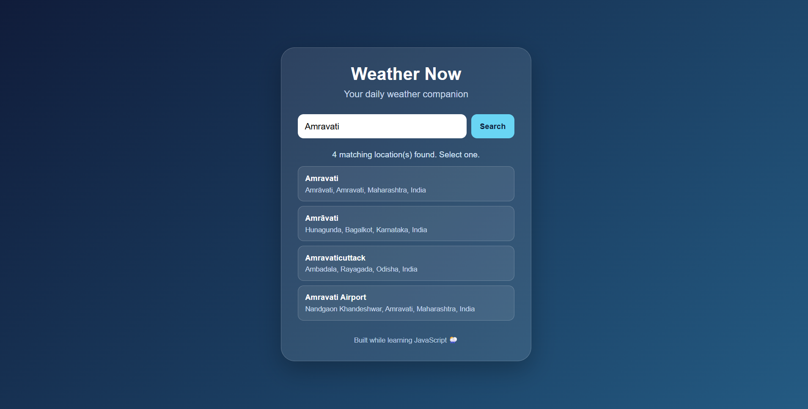
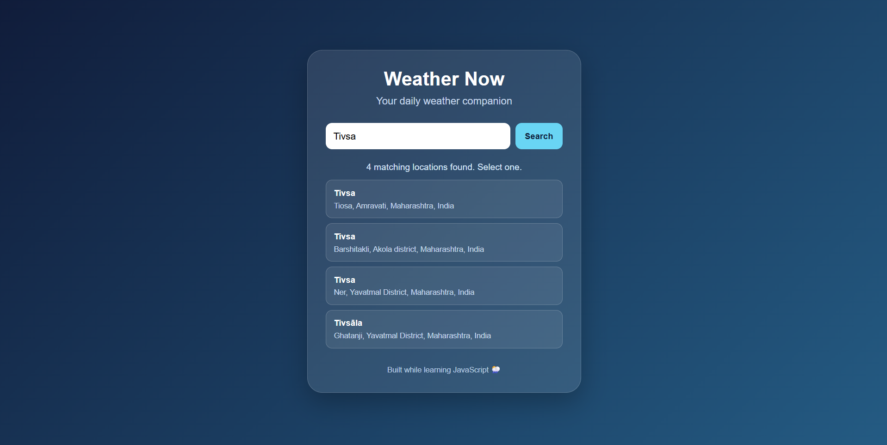
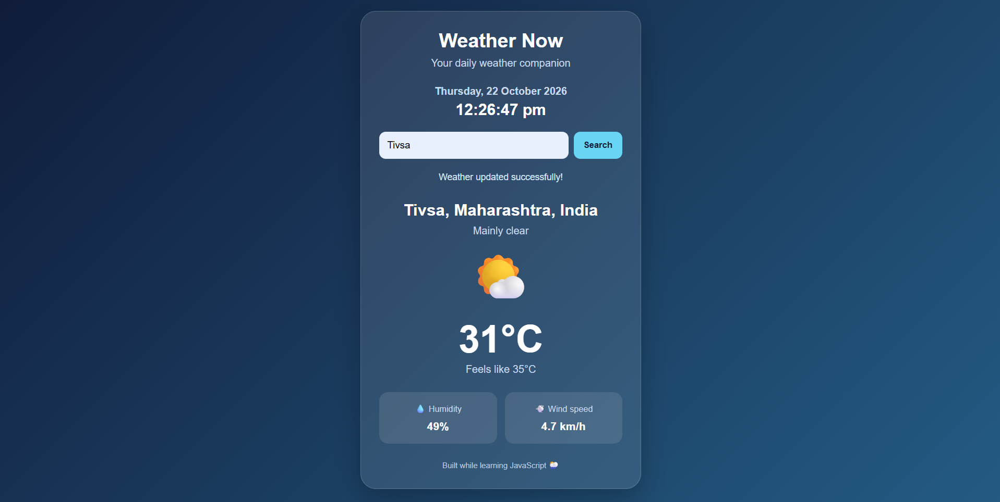

# 🌦️ Amravati Weather App

A responsive weather application built using **HTML, CSS, and JavaScript**. It allows users to search for locations in India and view current weather information using the Open-Meteo API.

## 📸 Screenshots

### User Interface

### API Response

### Weather Results

## ✨ Features

- 🔍 Search for locations by name
- 📍 Display matching locations for selection
- 🌡️ View current temperature and feels-like temperature
- 💧 Check humidity and wind speed
- 🌤️ Display weather conditions with icons
- 🕒 Show the current date and live time
- 📱 Responsive user interface
- ⚠️ Handle invalid locations and API errors

## 🛠️ Technologies Used

- **HTML5** — Website structure
- **CSS3** — Styling and responsive layout
- **JavaScript** — Application logic and DOM manipulation
- **Open-Meteo API** — Geocoding and weather data

## 📚 What I Learned

Building this project helped me practise:

- JavaScript variables, functions, objects, and arrays
- DOM manipulation and event listeners
- Form handling and user input validation
- Fetching API data using `fetch()`
- Asynchronous JavaScript with `async/await`
- Working with JSON responses
- Error handling using `try...catch`
- Creating HTML elements dynamically
- CSS Grid, responsive design, and styling
 
## 🌐 API

This project uses [Open-Meteo](https://open-meteo.com/) for location search and weather data.

No API key is required for the public API usage in this project.

## 🎯 Project Goal

This project was created to strengthen my JavaScript fundamentals by building a practical web application that retrieves and displays real-world data.

## 📄 License

Created for learning and educational purposes.